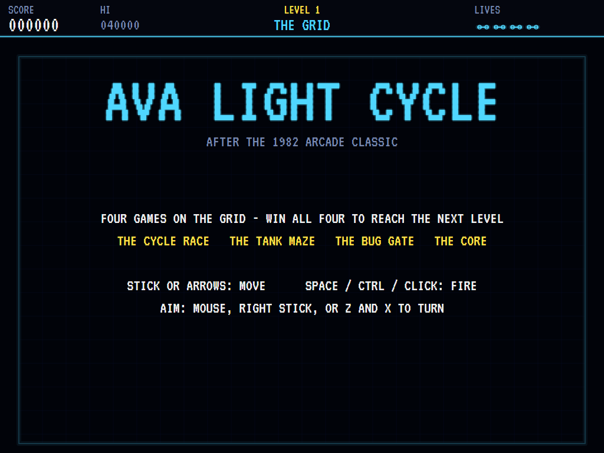
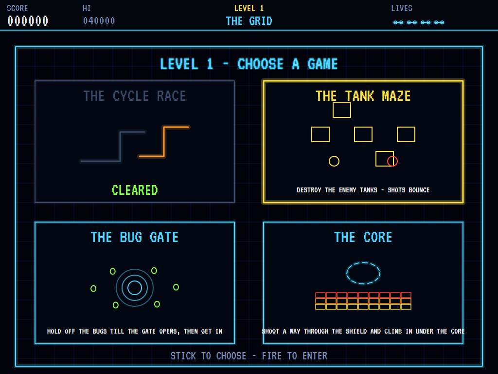
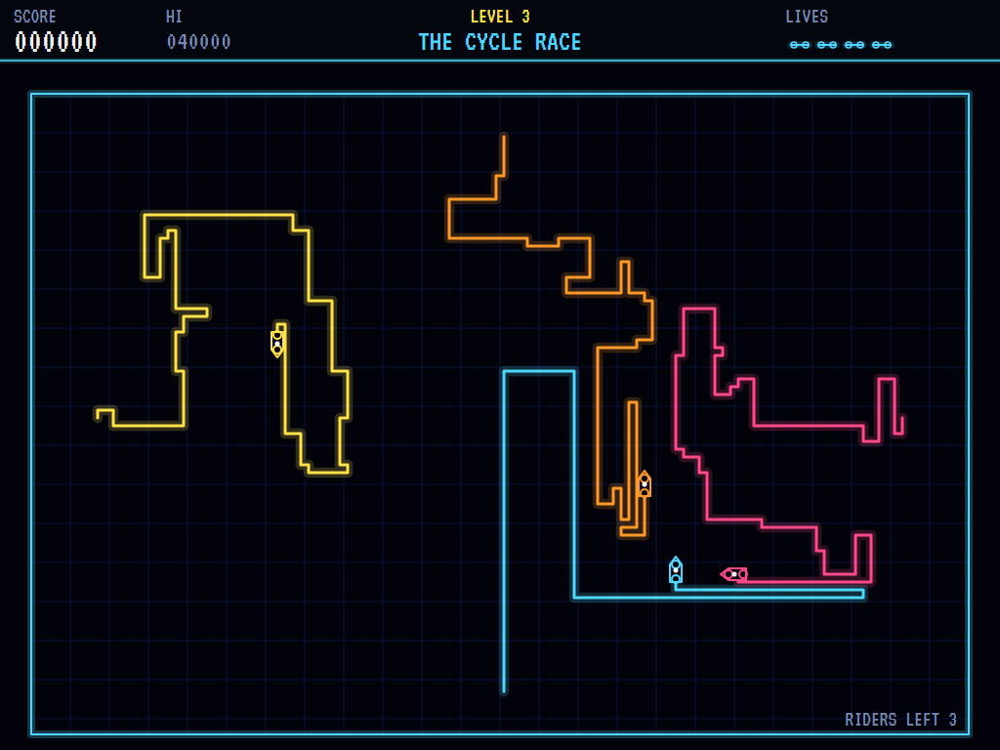
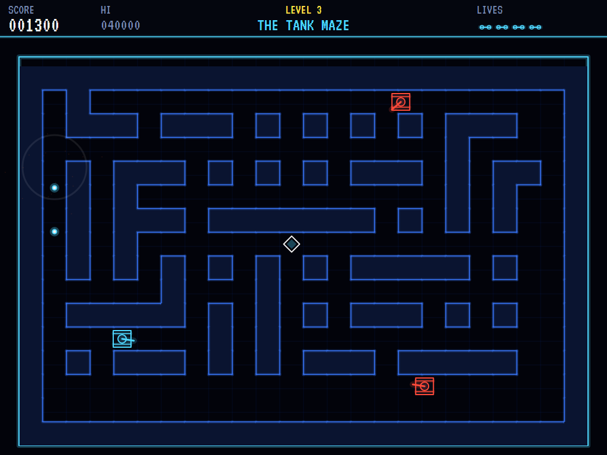
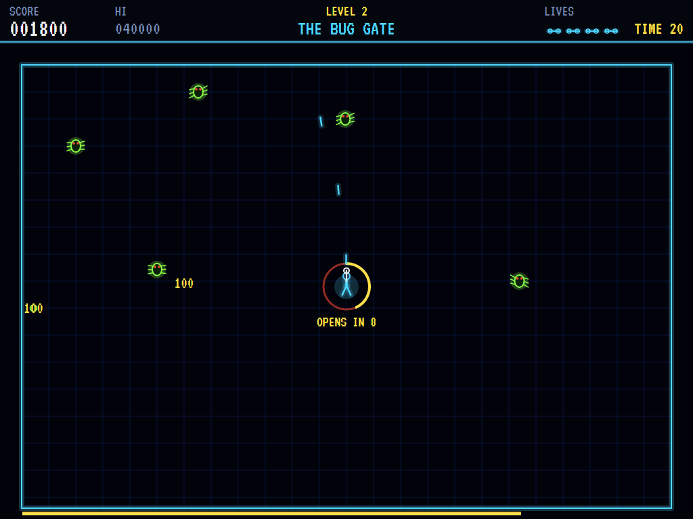
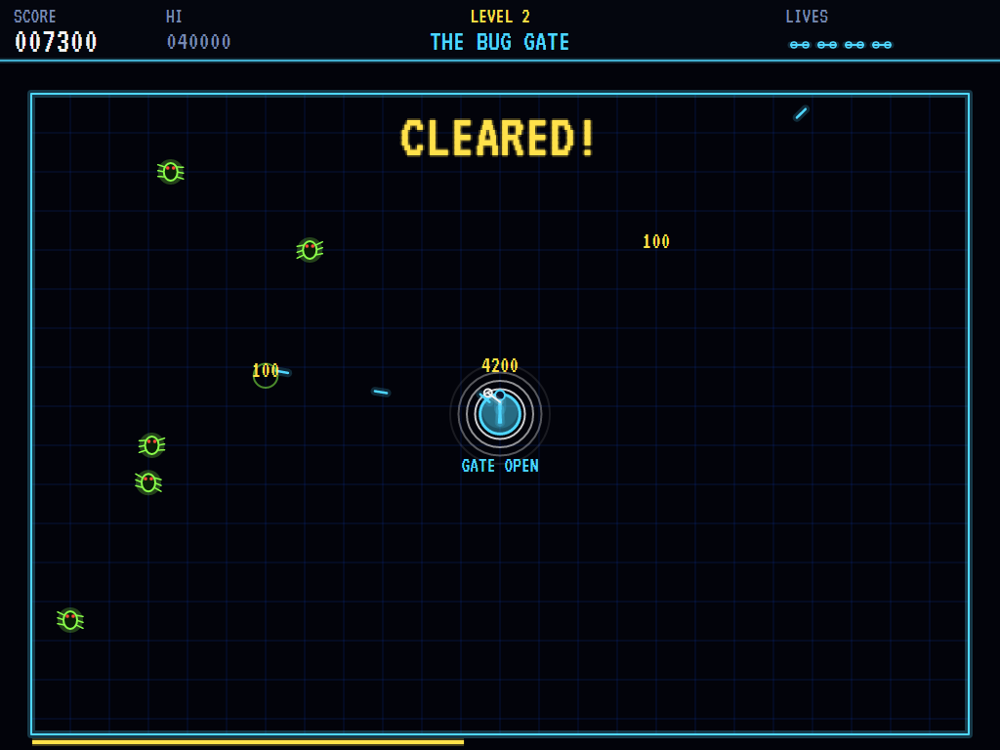
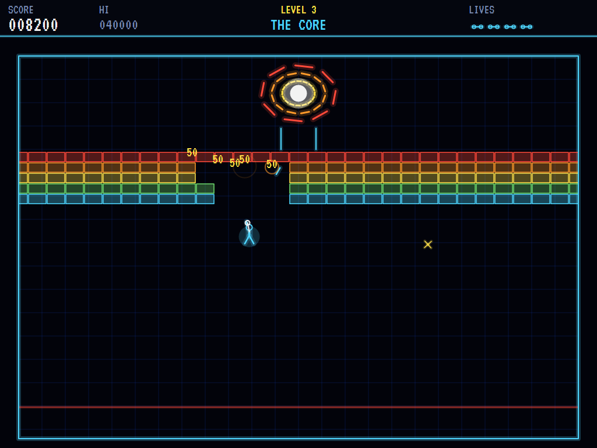
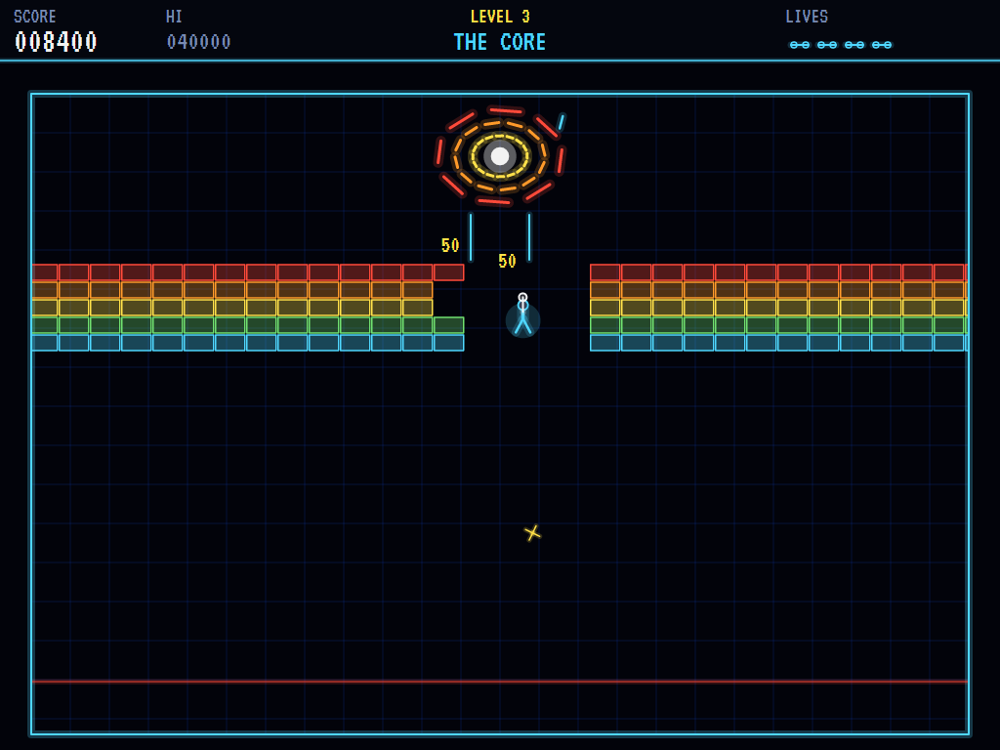
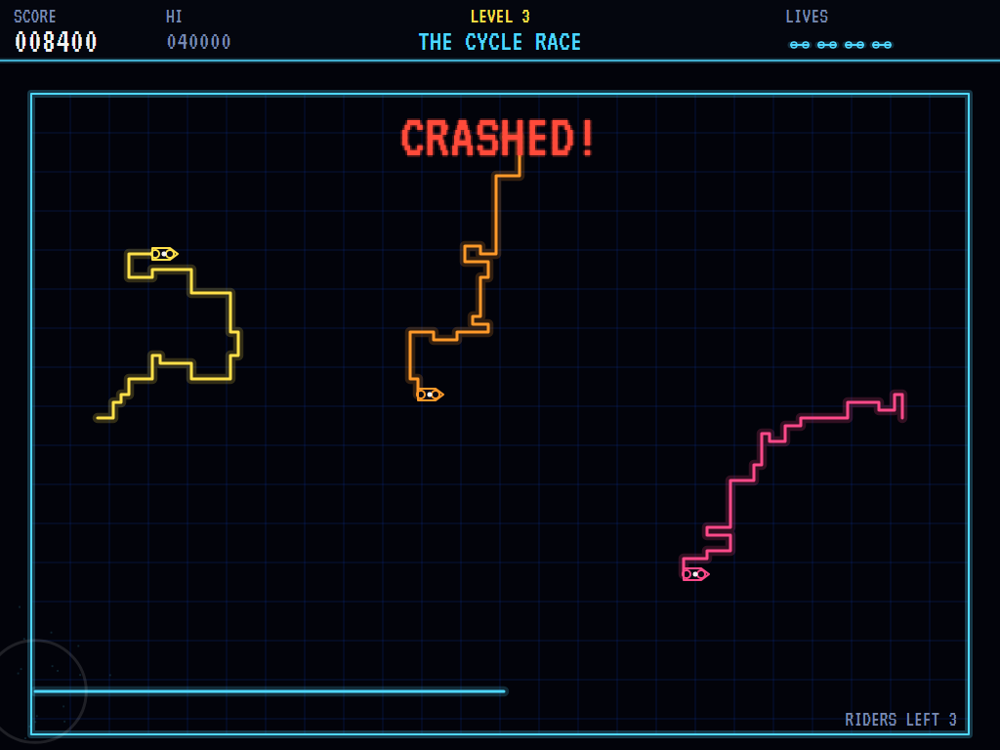
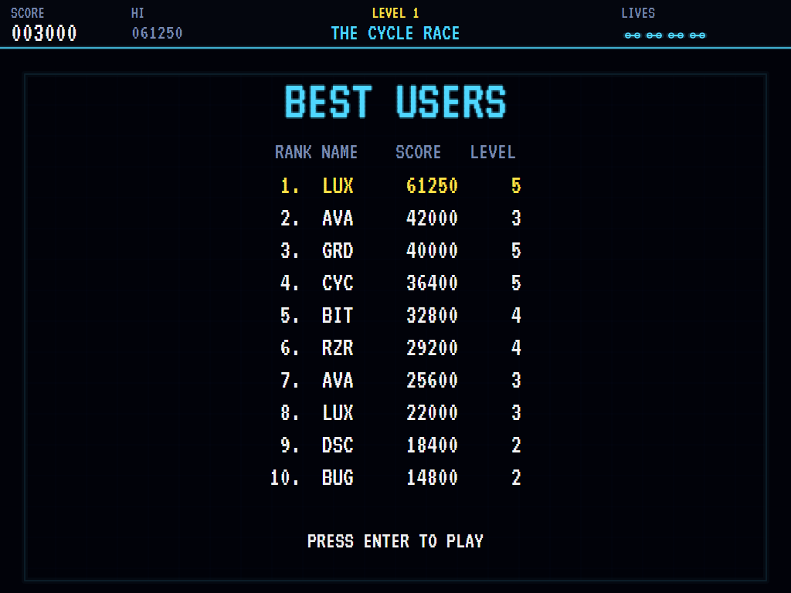

# AVA Light Cycle

[](https://github.com/Harlock123/AVALightCycle/actions/workflows/build.yml)

Four games on a glowing grid, in the style of Bally Midway's 1982 arcade game **Tron**, built with
.NET 10 and Avalonia UI. On each level you choose which of the four to play next: race light cycles
that leave walls behind them, fight tanks in a maze, fight your way through a swarm of grid bugs to
a gate, and shoot through a spinning shield into the core. Win all four to reach the next level.

## Features

- **The Cycle Race**:
  - **The race:** your cycle against one to four enemy riders, every cycle laying a wall of light behind it.
  - **The goal:** cut across their paths until they crash. A cycle that crashes takes its wall with it.
  - **Speed:** hold the trigger to slow down for tight turns.
  - **The riders:** they look further ahead and turn less erratically as the levels go up.
- **The Tank Maze**:
  - **The fight:** your tank against two to five enemy tanks in a new maze each time.
  - **Shots:** they bounce off the walls.
  - **Toughness:** enemies take two hits at first and three from level 3. One hit stops yours.
  - **Teleport:** the diamond in the middle sends any tank that drives onto it somewhere else in the maze.
- **The Bug Gate**:
  - **The gate:** it charges up in the middle of the grid while grid bugs pour in from the edges, crawling along the grid lines towards you.
  - **The goal:** hold them off with your disc until the gate opens, then get inside before time runs out.
- **The Core**:
  - **The shield:** a turning band of blocks guards the core and slowly comes down.
  - **Getting in:** shoot a way through, but you can only climb in directly beneath the core's door, and the gap you shoot drifts as the band turns. Time your climb.
  - **Dangers:** the core spits sparks, and if the band comes all the way down you're crushed.
- **Levels**: each brings more enemy riders, more and better-aimed tanks, faster bugs and a longer charge, and a thicker, faster shield. A level bonus of 5,000 × the level for clearing all four, and an extra life every 25,000.
- **Aiming**: the mouse, a gamepad's right stick, or the Z and X keys to turn.
- **Sound**: an original driving synth arpeggio, and electronic sounds for the discs, shells and ricochets, the derez, teleports, the gate, chipping the shield and the sparks. All mixed by OpenAL.
- **Attract mode**: leave the title alone for 15 seconds and a computer player takes on one of the four games. It:
  - rides like the enemy riders
  - hunts tanks and dodges their shells
  - shoots its way to the gate
  - digs a shaft through the shield and times its climb
- **A top-ten high-score table** with arcade-style initials entry; it records the level reached.
- **Gamepads** through SDL2, as well as the keyboard and mouse.
- **Any window size**: the screen scales to fit, letterboxed. **Ctrl+S** saves a screenshot.
- **One self-contained executable** per platform: Windows, macOS and Linux on Intel/AMD and ARM.

## Screenshots

| The title | Choose a game | The Cycle Race |
|:---------:|:-------------:|:--------------:|
|  |  |  |
| Four games on the grid. | One cleared, three to go. | Three enemy riders and their walls. |

| The Tank Maze | The Bug Gate | The gate opens |
|:-------------:|:------------:|:--------------:|
|  |  |  |
| Bouncing shots and the teleport diamond. | Holding off the bugs while the gate charges. | In, with time to spare. |

| The Core | Climbing in | Derezzed |
|:--------:|:-----------:|:--------:|
|  |  |  |
| Digging a shaft through the shield. | Up through the gap, under the door. | Into the wall. |

| The best users | | |
|:--------------:|:-:|:-:|
|  | | |
| The high-score table. | | |

The screenshots are made by the tests, which play the game in a real (headless) window; see
[Tests](#tests).

## Download and run

Ready-to-run builds for Windows, macOS and Linux, on both Intel/AMD and ARM, are on the
[Releases page](https://github.com/Harlock123/AVALightCycle/releases/tag/latest). **Latest build** is
rebuilt on every push to `main`. Each download is one self-contained executable: no .NET install is
needed.

| Platform | Archive |
|---|---|
| Windows | `AVALightCycle-win-x64.zip`, `AVALightCycle-win-x86.zip`, `AVALightCycle-win-arm64.zip` |
| macOS | `AVALightCycle-osx-arm64.tar.gz` (Apple silicon), `AVALightCycle-osx-x64.tar.gz` (Intel) |
| Linux | `AVALightCycle-linux-x64.tar.gz`, `AVALightCycle-linux-arm64.tar.gz`, `AVALightCycle-linux-arm.tar.gz` |

```bash
tar -xzf AVALightCycle-linux-x64.tar.gz     # or linux-arm64, linux-arm, osx-arm64, osx-x64
./AVALightCycle
```

On Windows, unzip and run `AVALightCycle.exe`. On macOS, if Gatekeeper refuses to open it, run
`xattr -d com.apple.quarantine AVALightCycle` once. Run with `--no-audio` for silence.

**Sound** comes through OpenAL Soft, built in for every platform. In a virtual machine the game
detects it and uses a larger audio buffer, so the sound doesn't break up.

**Gamepads** use SDL2, which is bundled for Windows, macOS and Intel/AMD Linux. ARM Linux builds need it
installed; without it the keyboard still works:

```bash
sudo apt install libsdl2-dev            # Debian / Ubuntu / Raspberry Pi OS
sudo pacman -S --needed sdl2-compat     # Arch / Omarchy
```

## Controls

| Input | Action |
|-------|--------|
| **Enter** | Start; skip a game's title card |
| **Arrows** (or **W** **A** **S** **D**) | Move: steer the cycle, drive the tank, run on foot; choose a game |
| **Mouse** | Aim at the pointer; click to fire |
| **Z** / **Q** and **X** / **E** | Turn the aim left and right |
| **Space** / **Ctrl** | Fire (on a light cycle: slow down) |
| **P** / **Esc** | Pause (Esc again to quit) |
| **M** | Mute |
| **Ctrl+S** / **Cmd+S** | Save a screenshot to the Pictures folder |

**Gamepad**: left stick or D-pad to move, right stick to aim, **A** or the right trigger to fire,
the shoulder buttons to turn the aim, **Start** to start and pause, **Back** (while paused) to quit.

**Entering initials**: type letters, or dial with **Up**/**Down** and accept with **Space**; **Left** /
**Backspace** go back; **Enter** finishes.

## Scoring

| What | Points |
|---|---:|
| An enemy rider crashed | 1,000 |
| The cycle race won | 2,000 × the level |
| A hit on a tank, a tank destroyed | 100, 1,000 |
| The tank maze won | 2,000 × the level |
| A grid bug | 100 |
| Into the gate | 3,000 + 100 for every second left |
| A shield block | 50 |
| Into the core | 3,000 + 500 for every row of the shield |
| All four games | 5,000 × the level |
| Extra life | every 25,000 |

## Tests

```bash
dotnet test AVALightCycle.slnx
```

The engine has no UI and runs in fixed 60 Hz steps, so it plays the same at any frame rate, and a seed
always plays the same game. The tests check:

- **The grid:**
  - the select screen and entering a game, and no replaying one already won
  - winning all four for the level bonus
  - losing a life and replaying the same game, and the last life ending it
- **The cycle race:** walls laid and turns made (never straight back), crashing into a wall, an enemy's wall going with it, winning, and the trigger slowing the cycle.
- **The tank maze:** every maze connected with every tank on open floor, driving tile to tile with the turret aiming on its own, shots bouncing, and how many hits each side takes.
- **The bug gate:** the gate staying shut until it opens, discs squashing bugs, time running out, and bugs crawling towards the runner.
- **The core:**
  - the band turning and coming down, and discs chipping it
  - climbing only beneath the door
  - getting into the core
  - hitting the shield, and being crushed
- **The machine:** the computer player winning each game at level one, the attract mode, extra lives, initials, the same game from the same seed, and the high-score file.

The screenshot tests draw the real screen in a headless window. To refresh the README's pictures:

```bash
GRID_SHOTS=$PWD/Images dotnet test tests/AVALightCycle.Tests --filter ScreenshotTests
```

To see how the computer player does at each game and level (for tuning):

```bash
GRID_PROBE=1 dotnet test tests/AVALightCycle.Tests --filter GridProbe --logger "console;verbosity=detailed"
```

## Building

```bash
dotnet build AVALightCycle.slnx
dotnet run --project src/AVALightCycle
```

Needs the .NET 10 SDK. The sounds are made by `tools/make_sounds.py` (standard-library Python):
`python3 tools/make_sounds.py` rewrites `src/AVALightCycle/Sounds`.

## Project structure

```
AVALightCycle/
├── AVALightCycle.slnx
├── src/AVALightCycle/
│   ├── Engine/
│   │   ├── GameEngine.cs        # States, the title and demo cycle, and the music
│   │   ├── GameEngine.Play.cs   # The select screen, lives, levels and scoring
│   │   ├── CycleStage.cs        # The cycle race, and the riders' way of choosing a turn
│   │   ├── TankStage.cs         # The tank maze: the maze, driving, turrets, bouncing shots
│   │   ├── BugStage.cs          # The bug gate: the gate, the runner, the grid bugs
│   │   ├── CoreStage.cs         # The core: the turning band, the door, the sparks
│   │   ├── GridPilot.cs         # The computer player, for the demonstration (and the tests)
│   │   ├── Entities.cs          # Controls and aiming, the runner, shots, and the stage itself
│   │   ├── HighScoreTable.cs, InitialsEntry.cs
│   │   ├── InputHandler.cs, ControllerManager.cs  # Keys, mouse and an SDL2 gamepad
│   │   └── SoundManager.cs      # Effects, the grid's pulse and the tunes through OpenAL
│   ├── Audio/                   # The OpenAL engine (from the author's AVABand)
│   ├── Views/                   # The neon grid, the four games and the screens
│   └── Sounds/                  # The synthesised effects and tunes
├── tests/AVALightCycle.Tests/   # Gameplay, screenshot and probe tests
├── tools/make_sounds.py
└── Images/                      # Screenshots
```

## About and licence

AVA Light Cycle © 2026 Lonnie Watson, under the [MIT License](LICENSE).

*Tron* © 1982 Bally Midway, and the film it came from belongs to its studio; the names belong to their
current owners. AVA Light Cycle is an independent, unofficial game in the style of the arcade game. Its
four games, their names, characters, graphics, sounds, tunes and code are its own; nothing is taken
from the arcade machine's program, graphics, sound or music, or from the film. It is not affiliated
with or endorsed by any rights holder.
